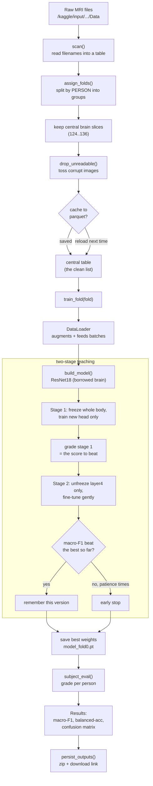
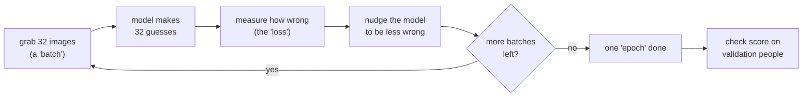

# train_kaggle.ipynb — architecture, configuration, and what to change when

This is one of three files about the same notebook:

| File | Answers |
|---|---|
| `train_kaggle_concept.md` | **Why** — the reasoning behind the method (leak-free splits, transfer learning, subject-level grading) |
| **this file** | **What** — the architecture, every setting, and which knob to turn when a run goes wrong |
| `train_kaggle_runbook.md` | **Where/when** — the Kaggle mechanics: running cells, GPU quota, saving outputs, error messages |

No prior experience assumed. Read top to bottom. Words in **bold** the first time
they appear are explained right there. Everything here is about the code itself,
so it stays true no matter where you run it; the Kaggle-only mechanics live in
the runbook.

---

## 1. A naming trap: "slice" means TWO different things

Clear this up before anything else — it confuses almost everyone.

The word **slice** shows up in two completely unrelated places in this project:

1. **Brain slice** — a physical cross-section of the head (Section 3 below).
   Controlled by the `central_lo` / `central_hi` settings.
2. **"Slice of data"** — a casual phrase for a chunk of *people* (Section 4, the
   folds).

They have nothing to do with each other. Whenever you see "slice," check which
one is meant. In these files, "brain slice" always means the picture, and we call
the data chunks "folds."

---

## 2. The tools we use (the "packages")

A **package** is a toolbox someone else already wrote, that we borrow. We list
them once here so the code later isn't a mystery.

| Package | In plain words | We use it to… |
|---|---|---|
| `numpy` | fast number-crunching on big lists | do math on scores and arrays |
| `pandas` | a spreadsheet inside Python (a **DataFrame** = a table) | keep the list of images, labels, folds |
| `Pillow` (`PIL`) | opens and edits image files | load each `.jpg` scan |
| `torch` (PyTorch) | the engine that runs the "brain" and does the learning | everything training-related |
| `torchvision` | add-on to torch, made for images | ready-made models + picture cleanup steps |
| `scikit-learn` (`sklearn`) | classic data-science helpers | make the split + compute scores |
| `os`, `re`, `random`, `glob`, `pathlib`, `zipfile`, `json` | small built-in helpers | find files, read names, bundle outputs |

You don't install any of these on Kaggle — they come pre-installed. That's a big
reason we use Kaggle (see the runbook).

**Where the GPU comes in:** a **GPU** is a chip that does thousands of small
calculations at once, which is exactly what training needs. `torch` automatically
uses it if it's turned on. On a plain CPU the same training can be 10–50× slower.

**Reproducibility.** `set_seed(42)` fixes the random number generators in
`random`, `numpy`, and `torch`, and puts cuDNN (the GPU's convolution library)
into deterministic mode. Same seed → same split, same shuffling, same result.
This is what lets you compare two runs and believe the difference came from your
change and not from luck.

---

## 3. Brain slices: why we keep only the central ones

An MRI machine doesn't take one photo. It scans the head like a loaf of bread —
cutting it into about **240 thin cross-sections**, from the top of the skull down
to the jaw. Each cross-section is saved as one image. Those are the "brain
slices."

```
   top of head
   ┌─────────┐  slice 1     ← mostly skull, barely any brain
   ├─────────┤  ...
   ├─────────┤  slice 124  ┐
   ├─────────┤  slice 128  ├─ CENTRAL: brain is biggest, most detail
   ├─────────┤  slice 132  │
   ├─────────┤  slice 136  ┘
   ├─────────┤  ...
   └─────────┘  slice 240    ← mostly neck/jaw, no brain
   bottom
```

The first and last slices are mostly skull, empty space, or neck — almost no
brain tissue. The **middle slices** show the most brain, which is exactly where
Alzheimer's damage appears.

So `central_lo = 124, central_hi = 136` means: **"keep only the 13 middle slices
(124 through 136) of each person, throw the rest away."** The code reads the
slice number straight out of the filename (`..._124.jpg`).

**Why this matters so much for speed:** each person has ~240 slices. Keeping 13
instead of 240 is roughly **18× less data** to process.

### Why this changed from 5 slices to 13

The notebook originally used `128..132` (5 slices). That was ~48× less data and
very fast — but it left only about **1,100 training images for an 11-million-
parameter model**, and the model simply memorized individual people rather than
learning what dementia looks like. (Section 11 shows the actual log from that
run.) Widening to 13 slices gives roughly **2.6×** the data for roughly 2.6× the
epoch time, and it is the single most effective fix.

**When to widen further** (e.g. `118..142` = 25 slices): if the model still
memorizes. **When to narrow back to `128..132`:** only for a quick smoke test
that the code runs at all — never for a number you plan to report.

---

## 4. How the data is split (folds) — counting PEOPLE, not pictures

This is the part people most often get wrong in their heads. The golden rule:
**we split by PERSON, never by picture** (the concept file explains why — it
prevents cheating, because two slices of the same head are nearly the same
picture). So all the counting below is in *people*.

Let's use a round number, **100 people**, to see the math:

```
100 people total
   │
   ├─ test_frac = 0.20  →  20 people LOCKED AWAY
   │                        (the "final exam" — touched once, ever, at the very end)
   │
   └─ 80 people left  (called the "dev" set)
         │
         └─ n_folds = 5  →  cut into 5 equal groups of 16 people
                fold 0: 16 people
                fold 1: 16 people
                fold 2: 16 people
                fold 3: 16 people
                fold 4: 16 people
```

So yes — **16 people per fold**, not 16 pictures. The locked-away people are
marked `fold == -1` in the table, which is how the training code knows to never
touch them.

**One training run uses one fold as the quiz and the other four to study:**

```
Training on fold 0:
   validation (the "quiz") = fold 0        = 16 people
   training   (the "study")= folds 1,2,3,4 = 64 people
```

### Your actual numbers

The example above uses 100 people for clean math. The OASIS set here has ~350, so
in practice:

```
~350 people total
   ├─ ~70 locked away for the final exam (fold = -1)
   └─ ~280 dev people, cut into 5 folds of ~56

Training on fold 0:
   validation (the "quiz") = fold 0        ≈  56 people
   training   (the "study")= folds 1,2,3,4 ≈ 224 people
```

Now bring back the brain slices from Section 3. Each person has 13 slices, so in
actual *pictures*:

- Study set ≈ 224 people × 13 = **~2,900 images**
- Quiz set  ≈  56 people × 13 = **~730 images**

### A warning about how small the quiz really is

Your 56 quiz people break down roughly as **42 no_dementia / 10 very_mild /
4 mild_moderate**. Four people in the rarest class means **one person changing
their answer swings macro-F1 by about 0.05**. A single fold's score is mostly
noise.

Practical consequence: do not conclude "change X helped" from one fold moving
0.02. Either run all five folds, or accept that you're reading tea leaves.

### What `run_folds` means and why it's your main quota lever

`run_folds` is simply a to-do list of *which folds to run right now*:

- `run_folds = [0]` → "run fold 0 only, then stop." **One** training run. Cheap.
- `run_folds = [0,1,2,3,4]` → "run all five, each as its own separate run."
  **Five times** the work and five times the GPU cost.

Running all five (each fold takes a turn being the quiz) and averaging gives a
trustworthy number with a "give or take." This is called **cross-validation**.

**Practical rule:** keep `[0]` while you're checking that things *run*. Switch to
`[0,1,2,3,4]` whenever you want to actually *believe* a number. (The runbook
explains why this is also the biggest lever on your free GPU hours.)

---

## 5. The training session at a glance (architecture diagram)

This is the whole journey of one run, from files on disk to a report card.



**How to read it:** everything above `train_fold` happens **once** and is cheap.
The box "two-stage teaching" is where the GPU time (and your Kaggle quota) goes.
The `cache` diamond is the trick that lets you skip the slow file-scan on reruns.

Note the `grade stage 1` box — it's what makes the saved checkpoint safe, and
Section 7 explains it.

The labels in the diagram map onto the notebook's numbered sections like this:

| Notebook section | Diagram boxes |
|---|---|
| 0. GPU sanity check | (before everything) |
| 1. Config | supplies every setting below |
| 2. Rebuild the split | `scan` → `assign_folds` → central slices → `drop_unreadable` → cache |
| 3. Dataset + transforms | `DataLoader` / augmentation |
| 4. Model factory | `build_model`, `set_trainable`, `freeze_frozen_bn`, `param_groups` |
| 5. Train / eval helpers | `run_epoch`, `subject_eval` |
| 6. Two-stage training | the whole `TRAIN` subgraph |
| 7. Results | the report card |
| 8. Persist outputs | `persist_outputs` |

---

## 6. What happens inside training (epochs and batches)

The slow part is a loop that repeats many times. Understanding it explains *why*
it takes time.



- A **batch** = a small handful of images processed together (we use 32).
- The **loss** = a single number for "how wrong were those guesses." Lower is
  better. The whole point of training is to push this down.
- One **epoch** = one full pass over *all* the study images.

**"Do we train on the same images every epoch?"** Yes. Within one run, those same
~2,900 study images are shown again and again — once per epoch. If
`stage2_epochs = 12`, the model may see each image up to 12 times. Each time,
**augmentation** makes it look different, so the model can't just memorize exact
pixels.

### What augmentation actually does now

Augmentation = randomly distorting each image a little, every time it's shown, so
the model sees a slightly new picture each epoch. The original settings were far
too gentle (a 10° rotation and a flip), which is *why* memorizing was easy. Now
(`build_tf(train=True)`):

| Step | What it does | Why |
|---|---|---|
| `RandomResizedCrop(scale=0.75–1.0, ratio=0.9–1.11)` | zooms/crops to a random sub-region, with a slight aspect-ratio wobble | the framing changes every epoch, so exact pixel positions are useless to memorize |
| `RandomHorizontalFlip(0.5)` | mirrors left↔right half the time | brains are near-symmetric, so this is safe and doubles the variety |
| `RandomAffine(12°, translate 6%)` | small rotate + shift | breaks "the damage is always at pixel (100,80)" memorization |
| `ColorJitter(brightness 0.2, contrast 0.2)` | changes exposure | different scanners produce different brightness |
| `RandomErasing(p=0.25, scale 0.02–0.12)` | blanks out a small random patch, 1 time in 4 | forces the model to use more than one region of the brain |

Validation and test images get **none** of this — they're resized, converted to
numbers, normalized, and nothing else (`build_tf(train=False)`). You grade on
clean images, always. This is also why validation is deterministic: the same
model on the same quiz always gives the same score.

**Normalization** (`IMAGENET_MEAN` / `IMAGENET_STD`) rescales pixel values to the
same range the borrowed model saw during its original training. Skipping it makes
the borrowed knowledge much less useful.

So total time ≈ `(number of batches) × (epochs) × (time per batch)`. Every
GPU-saving trick in the runbook is really about shrinking one of those three
numbers.

---

## 7. Why TWO stages, not one loop?

A very natural question: isn't training just one "predict → measure → improve"
loop? The loop itself *is* just that. The two stages are only about **which parts
of the model are allowed to change** during that loop.

Recall from the concept file: we borrowed a model that already knows how to see
(edges, shapes, textures) from millions of photos. We chopped off its final
decision layer and bolted on a **brand-new, untrained** one for our 3 classes.

Here's the danger:

```
Fresh, clueless new layer   +   Precious borrowed knowledge
   (makes wild guesses)            (took millions of images to build)
```

If we train everything at once from the very start, the wild early mistakes from
the clueless new layer flood backward and **scramble the precious borrowed
knowledge** before the new layer settles. It's like giving a brand-new intern
power to rewrite the whole company playbook on day one.

So we do it gently, in two stages:

| Stage | What can change | Why |
|---|---|---|
| **Stage 1** | Only the new layer (the "head"), 1,539 numbers. Everything else **frozen**. | Let the new layer get roughly sensible *without* risking the borrowed knowledge. |
| **Stage 2** | `layer4` + head (8.4M of 11.18M), with a **tiny** learning rate. | Polish the *deepest, most task-specific* part, and leave the general vision machinery alone. |

**Frozen** means `requires_grad = False`: the numbers in that block are still used
to make predictions, but they are never updated. `set_trainable()` is the function
that does the freezing.

### What changed: stage 2 no longer unfreezes everything

Stage 2 used to unlock the *whole* model. On ~1,100 images that was hopeless —
11 million adjustable numbers against 1,100 examples is an invitation to
memorize. Now `CFG["freeze_until"]` controls how much gets unlocked.

### Where ResNet-18's 11 million numbers actually live

This is worth internalizing, because it makes the `freeze_until` choice obvious:

| Block | Parameters | Share |
|---|---:|---:|
| conv1 + bn1 | 9,536 | 0.1% |
| layer1 | 147,968 | 1.3% |
| layer2 | 525,568 | 4.7% |
| layer3 | 2,099,712 | 18.8% |
| **layer4** | **8,393,728** | **75.1%** |
| fc head (3 classes) | 1,539 | 0.0% |
| **total** | **11,178,051** | |

The capacity is nearly all in `layer4`. So:

| `freeze_until` | Trains | Trainable | Use when |
|---|---|---:|---|
| `"head"` | head only | 1,539 (0.01%) | a **linear probe** — strongest anti-memorizing setting, and a serious baseline, not a cop-out |
| `"layer4"` | layer4 + head | 8.40M (75%) | **the default** |
| `"layer3"` | layer3 onward | 10.49M (94%) | if the model is *under*-fitting |
| `None` | everything | 11.18M (100%) | the old behavior; don't |

Notice `"layer3"` still trains 94% of the model — freezing the early blocks
barely reduces capacity, because those blocks are tiny. `freeze_until` is a
**coarse dial**, not a fine one. This is why the default is `"layer4"`.

The notebook prints the exact count each time, e.g.
`trainable: 8.40M / 11.18M params (freeze_until=layer4)`. Read that line — it is
the fastest way to confirm the setting took effect.

### Stage 1 is the score to beat

After stage 1 finishes, the notebook grades it (`[s1 end] val_macroF1=...`) and
stores that as the current best. Stage 2 can only *replace* it by scoring
**strictly higher** on validation macro-F1. If fine-tuning is hopeless at this
data size, you automatically keep the stage-1 model instead of the least-bad
stage-2 epoch. This is a safety net: your saved checkpoint can never be worse
than the linear probe.

---

## 8. Every configuration setting explained

All settings live in the `CFG` dictionary in Section 1 of the notebook. Below,
each one: what it means, what changing it does, and **what to check before you
touch it**.

### Data + split settings

| Setting | Plain meaning | If you increase it | Check before changing |
|---|---|---|---|
| `data_root` | where the images live | — | Auto-resolved by `resolve_data_root()`, which falls back to searching `/kaggle/input/**/Data`. Only touch it if the printed `data_root ->` line is wrong. |
| `seed` | the "fixed dice" for reproducibility | different random split & shuffling | Keep it fixed at 42 while comparing ideas, or comparisons become unfair. |
| `test_frac` | share of people locked away for the final exam (0.20) | fewer people to learn from | Rarely change. Smaller test = shakier final number. |
| `n_folds` | how many equal groups the rest is cut into (5) | — | 5 is standard. Don't change mid-project. |
| `run_folds` | **which** folds to run now (Section 4) | more folds = proportionally longer run | `[0]` for smoke tests; `[0,1,2,3,4]` for any number you'll believe. **Your main GPU-cost lever.** |

### Brain-slice + image settings

| Setting | Now | Plain meaning | Check before changing |
|---|---|---|---|
| `central_lo`, `central_hi` | `124`, `136` | which brain slices to keep (Section 3) | Widen to `118..142` if still memorizing; narrow to `128..132` only for smoke tests. **Changing this rebuilds the cache automatically** — the cache filename contains the window. |
| `img_size` | `224` | pixel size each image is resized to | The borrowed model expects 224. Leave it unless you know why. |
| `batch_size` | `32` | images processed together | If you get "out of memory," **lower** this (16, or 8). |

### Learning settings

| Setting | Now | Plain meaning | Check before changing |
|---|---|---|---|
| `backbone` | `resnet18` | which borrowed brain to use — `"resnet18"`, `"resnet50"`, or `"efficientnet_b0"` | Start with resnet18. Try `resnet50` only after resnet18 works, then compare. **If you switch to `efficientnet_b0` you must also change `freeze_until`** — see the note below. |
| `freeze_until` | `"layer4"` | how much of the body stage 2 may change (Section 7) | `"head"` if still memorizing; `"layer3"` if under-fitting. |
| `stage1_epochs` | `3` | rounds of training the new head only | 3 is plenty; the head learns fast. |
| `stage2_epochs` | `12` | max rounds of fine-tuning | Early stopping usually ends it sooner. Also sets the length of the cosine decay schedule. |
| `lr_head` | `1e-3` | learning speed for the head in stage 1 | Leave unless training looks unstable. |
| `lr_head_ft` | `2e-4` | learning speed for the head in stage 2 | The head is allowed to move faster than the body. |
| `lr_backbone` | `2e-5` | learning speed for unfrozen body blocks in stage 2 | Keep it tiny on purpose. Halve it if memorizing. |
| `weight_decay` | `1e-2` | "stay humble" pressure | Was `1e-4`, which is nearly nothing. Raise to `3e-2` if still memorizing. |
| `label_smoothing` | `0.05` | forbids the model from being 100% certain | Raise to `0.1` if still memorizing. |
| `dropout` | `0.5` | randomly ignores half the head's inputs each step | Raise to `0.6` if still memorizing. |
| `patience` | `4` | no-improvement rounds allowed before stopping | Lower = saves time; higher = more thorough. |
| `num_workers` | `2` | background helpers that load images | 2 is safe on Kaggle. Raising it sometimes crashes. |

**The `freeze_until` / `backbone` coupling.** `freeze_until` names a block, and
the block names differ per architecture. The notebook's `BLOCK_ORDER` map says:

- `resnet18` / `resnet50`: `conv1, bn1, layer1, layer2, layer3, layer4`
- `efficientnet_b0`: `features.0` … `features.8`

So `freeze_until = "layer4"` is meaningless for EfficientNet and the assertion in
`set_trainable()` will stop you with `'layer4' not in [...]`. Use
`freeze_until = "features.7"` (or similar) for that backbone. `"head"` and `None`
work for all three.

**The learning knobs, in plain words:**

- **Learning rate (`lr_*`)** — how big a correction step the model takes each time
  it's wrong. Big step = fast but reckless; small step = slow but careful. The
  fresh head gets a normal step; the borrowed body gets a *tiny* one so we polish
  it instead of wrecking it. Having two different rates at once is called
  **discriminative learning rates**, and `param_groups()` is the function that
  builds them.

- **Cosine decay** — on top of that, stage 2 slowly *reduces* the learning rate
  over its epochs, following a cosine curve down to nearly zero
  (`CosineAnnealingLR`). Big careful steps early, tiny settling steps late. You
  don't configure this; it's automatic and its length is `stage2_epochs`.

- **`weight_decay`** — a gentle nudge telling the model "prefer small, modest
  numbers inside yourself." A model with huge internal numbers tends to *memorize*
  specific training people (**overfitting**). The optimizer is **AdamW**, whose
  whole point is applying this pressure cleanly. The old value of `0.0001` was far
  too weak for a dataset this small; `0.01` is a real amount of pressure.

- **`label_smoothing`** — instead of teaching "this is 100% no_dementia," we teach
  "this is 95% no_dementia." Sounds trivial, but demanding 100% certainty is
  exactly what pushes a model to memorize individual training examples.

- **`dropout`** — during training, randomly switch off half the numbers feeding
  the final layer. The model can't rely on any single clue, so it learns several
  independent ones. It is a `nn.Dropout` placed in front of the new `nn.Linear`.

- **`patience`** (part of **early stopping**) — after each stage-2 epoch we check
  the quiz score. If it doesn't improve, that's a strike. `patience = 4` means
  "after 4 epochs in a row with no improvement, stop." We always keep the *best*
  version we saw, not the last one.

### The three "saver" switches

| Setting | Plain meaning | Turn it off if… |
|---|---|---|
| `use_sampler` | show rare (sick) groups more often, so the model doesn't ignore them | you want to compare against weighted-loss behavior |
| `use_amp` | **mixed precision** — do the math in a lighter number format = ~2× faster on GPU | you ever see strange `NaN` losses (very rare) |
| `cache_split` | save the cleaned image list so reruns skip the slow file scan | you changed the data itself and want a fresh scan |

**More on `use_amp` (mixed precision):** numbers can be stored "heavy and precise"
or "light and approximate." Most of training doesn't need full precision, so AMP
does the math in the *light* format where it's safe (`torch.autocast`), while a
`GradScaler` keeps the tiny float16 gradients from vanishing to zero. About 2×
faster with basically no accuracy loss. A free win — keep it on. It is
automatically disabled on CPU (`AMP = use_amp and device == "cuda"`), so leaving
it `True` never breaks a CPU run.

**More on `use_sampler`:** the image-appropriate way to fight class imbalance.
Instead of inventing fake images (SMOTE/ADASYN don't fit raw images), a
`WeightedRandomSampler` simply *shows the rare groups more often* during study.
Note it is **either/or** with the other imbalance fix: when `use_sampler` is on,
the loss function's class weights are set to `None`, because balancing twice
over-corrects toward the rare classes.

**Rule of thumb:** the settings a beginner should routinely change are
`run_folds`, `central_lo/hi`, `freeze_until`, `backbone`, and `batch_size` (only
if you hit memory errors). Leave the rest until you've read Section 11.

---

## 9. Key implementation details (worth understanding)

**The split is rebuilt, not loaded.** Old saved splits have Windows paths that
don't exist on Kaggle. `assign_folds()` recreates the exact same groups because
`seed` is fixed. See `train_kaggle_concept.md` Step 2 for why.

**Four folders become three classes.** `FOLDER_TO_LABEL` maps the raw folders to
labels, and folds `Moderate Dementia` into `Mild Dementia` (label 2) — there are
too few Moderate subjects to be a class of their own.

**Grayscale → 3 colors.** MRI scans are gray, but the borrowed model expects color
(3 channels). We copy the gray shade into all three channels. It adds no
information — it just matches the expected format.

**Two layers of defense against corrupt files.** `drop_unreadable()` opens and
fully loads every central-slice image *once*, before training, and drops the ones
PIL can't decode (it uses `.load()`, not `.verify()`, because `verify()` misses
some truncation). Separately, `ImageFile.LOAD_TRUNCATED_IMAGES = True` lets PIL
tolerate JPEGs that are merely cut off at the end instead of raising.

**Retry on bad reads.** Kaggle file mounts occasionally hand back a half-read
file at training time. `OasisDS.__getitem__` retries the same file a few times,
then falls back to the next index, so a single glitch never kills a whole epoch.

**Two optimizers, on purpose.** Stage 1 only updates the head; stage 2 updates
layer4 + head at two different speeds. That's why the code builds a fresh
`AdamW` between stages (see Section 7).

**Frozen BatchNorm.** This one is subtle but real. **BatchNorm** layers keep a
running average of how bright/contrasty the images they've seen are. Even when a
block is frozen, PyTorch's `model.train()` keeps *updating those averages*. On a
tiny dataset that quietly drags the borrowed ImageNet statistics toward your 2,900
images — a hidden form of memorizing. `freeze_frozen_bn()` puts frozen BatchNorm
layers into eval mode at the start of each training epoch so their averages stay
pinned.

**`drop_last=True` on the training loader.** Drops the final undersized batch, so
BatchNorm never sees a batch of 1 or 2 images (which produces garbage statistics).

**Early stopping keeps the *best*, not the *last*** — and the stage-1 model is the
starting "best," so the saved checkpoint can never be worse than the linear probe.

**Per-person grading.** `subject_eval()` averages all of one person's
picture-guesses into a single probability vector for that person
(**mean-probability aggregation**), takes the highest as that person's answer,
and scores per person — the honest way to grade (concept file, Step 5). It
returns macro-F1, balanced accuracy, validation loss, a per-class report, and a
confusion matrix.

**Validation loss is tracked.** Watching train loss alone hides overfitting until
the score has already collapsed. Passing `criterion` into `subject_eval()` is
what turns it on. See Section 11 for how to read it.

**Which metric decides everything.** `macro_f1` — the average F1 across the three
classes, each weighted equally. That's the point: plain accuracy would let the
model ignore the rare sick classes entirely and still look good. The reference
number to beat is **0.767**, the accuracy you get by lazily predicting
`no_dementia` for every single person.

**Checkpoints are dictionaries.** `model_fold{k}.pt` holds the weights *plus* the
config, fold number, best score, which epoch won, and the class names — so a
downloaded file explains itself. Reload code is in the runbook.

---

## 10. Reading the training log

Stage 1 prints one line per epoch plus a summary; stage 2 prints a richer line:

```
  [s1 1] train_loss=0.9620
  [s1 2] train_loss=0.7606
  [s1 3] train_loss=0.7160
  [s1 end] val_macroF1=0.5310  val_balAcc=0.5480
  [s2 1] train_loss=0.8120  val_loss=0.8402  gap=+0.028  val_macroF1=0.5120  val_balAcc=0.5340
```

- `[s1 end]` is the linear-probe baseline — the score stage 2 must beat.
- **`gap = val_loss − train_loss` is your overfitting meter.**

| What you see | What it means | What to do |
|---|---|---|
| gap near 0, val F1 climbing | healthy learning | nothing — let it run |
| gap growing each epoch, val F1 falling | memorizing | tighten (Section 11) |
| train loss stuck high, val F1 flat and low | **under**-fitting — over-corrected | loosen: `freeze_until="layer3"`, `weight_decay=1e-3` |
| val F1 bouncing ±0.05 randomly | probably just the 4-person rare class | run more folds before concluding anything |

At the end of a fold you'll see
`saved -> /kaggle/working/model_fold0.pt  (best val_macroF1=0.61 @ s2e5)` — the
`@` tag tells you which epoch won (`stage1` means stage 2 never beat the probe).

---

## 11. The overfitting story, and the seven fixes

This section exists because of a real run. Here's what it printed:

```
  [s1 1] train_loss=0.9620
  [s1 2] train_loss=0.7606
  [s1 3] train_loss=0.7160
  [s2 1] train_loss=0.5125  val_macroF1=0.4850  val_balAcc=0.5040
  [s2 2] train_loss=0.2590  val_macroF1=0.4365  val_balAcc=0.4357
  [s2 3] train_loss=0.1630  val_macroF1=0.4069  val_balAcc=0.4190
```

Read it like this: **train loss fell 3× while the validation score fell every
single epoch.** That is the textbook signature of **overfitting** — the model
isn't learning what Alzheimer's looks like, it's learning what *these specific
224 people* look like. Final accuracy was 0.68, *below* the 0.767 you'd get by
lazily guessing "no_dementia" for everyone.

The cause was arithmetic: **11 million adjustable numbers, ~1,100 training
images, and augmentation too weak to hide the repeats.**

### The seven fixes now in the notebook

| # | Fix | Where | Explained in |
|---|---|---|---|
| 1 | **More data** — 5 → 13 brain slices per person (~2.6× images) | `central_lo/hi` | §3 |
| 2 | **Freeze most of the body** — stage 2 trains 75% instead of 100% | `freeze_until` | §7 |
| 3 | **Pin BatchNorm statistics** in frozen blocks | `freeze_frozen_bn()` | §9 |
| 4 | **Real augmentation** — crop, affine, erasing | `build_tf()` | §6 |
| 5 | **100× more weight decay** (`1e-4` → `1e-2`), plus dropout 0.5 and label smoothing 0.05 | `CFG` | §8 |
| 6 | **Discriminative learning rates + cosine decay** | stage 2 optimizer | §8 |
| 7 | **Stage 1 is the floor** — stage 2 must beat it or be discarded | `train_fold()` | §7 |

### If it still overfits — tighten in this order

Roughly most → least effective:

1. `central_lo=118, central_hi=142` — more real data beats every other fix
2. **augmentation** — already aggressive; the next step up is **mixup** (blending
   two images and their labels), which is not in the notebook yet. Add it before
   you start loosening anything else.
3. `freeze_until = "head"` — a linear probe on ~3k images is genuinely
   competitive at this size, not a cop-out
4. `weight_decay = 3e-2`
5. `lr_backbone = 1e-5`
6. `dropout = 0.6`
7. `label_smoothing = 0.1`

Change **one** at a time, and judge on all five folds — a single fold's 0.02 move
is noise.

If instead **train loss stays high and val F1 plateaus low**, you've over-corrected
— loosen the other way (`freeze_until = "layer3"`, `weight_decay = 1e-3`).

---

## 12. Next steps once the recipe works

- Set `run_folds = [0,1,2,3,4]` for full cross-validation and report **mean ± std**
  (Section 7 of the notebook prints exactly this).
- **Only evaluate the test set (`fold == -1`) once**, after the recipe is frozen.
  Every peek at it costs you the right to call the number honest.
- Try `backbone = "resnet50"` as a second model and compare macro-F1.
- Add **Grad-CAM** on a few subjects — it highlights which pixels drove the
  prediction, a sanity check against hidden leakage (see `research.md` §9b). If
  the heat lands on the skull outline rather than brain tissue, something is
  wrong with the data, not the model.

---

For the day-to-day mechanics of actually running this on Kaggle — GPU hours,
saving your checkpoints, error messages — continue to `train_kaggle_runbook.md`.
