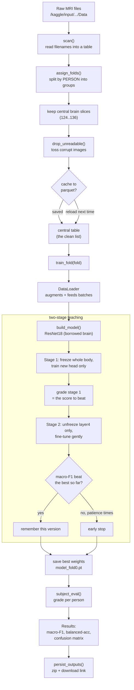
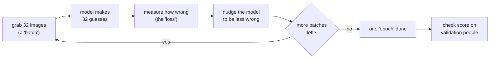

# Running train_kaggle.ipynb (the hands-on guide)

The other file (`train_kaggle_concept.md`) explains **why** we do each thing.
This file explains **how** — the actual tools, the code, every setting, and the
day-to-day routine for running it on Kaggle without running out of your free
hours.

No prior experience assumed. Read it top to bottom. Words in **bold** the first
time they appear are explained right there.

---

## 1. What a "notebook" is, and how to run it

A Kaggle **notebook** is a web page made of stacked boxes called **cells**. Each
cell holds a bit of code. You run cells **top to bottom**, one at a time (or all
at once with "Run All"). Each cell must finish before the next makes sense,
because later cells use things earlier ones created.

Our notebook has 8 numbered sections:

| Section | What it does |
|---|---|
| 0. GPU sanity check | Confirms the GPU is actually on before you waste time |
| 1. Config | All the knobs and settings in one place |
| 2. Rebuild the split | Decide which people go in which group |
| 3. Dataset + transforms | Load, clean, and augment each picture |
| 4. Model factory | Build the "brain," and decide which parts may change |
| 5. Train / eval helpers | The grading and one-round-of-teaching tools |
| 6. Two-stage training | The driver that actually does the learning |
| 7. Results | The final report card |
| 8. Persist outputs | Save your checkpoints so a dead session can't eat them |

**Golden habit:** run sections 0 → 5 once (they just define tools and are fast),
then section 6 is the slow one that does the real work. **Always finish with
section 8** — see Section 16 for the horror story that motivated it.

---

## 2. The tools we use (the "packages")

A **package** is a toolbox someone else already wrote, that we borrow. We list
them once here so the code later isn't a mystery.

| Package | In plain words | We use it to… |
|---|---|---|
| `numpy` | fast number-crunching on big lists | do math on scores and arrays |
| `pandas` | a spreadsheet inside Python (a **DataFrame** = a table) | keep the list of images, labels, folds |
| `Pillow` (`PIL`) | opens and edits image files | load each `.jpg` scan |
| `torch` (PyTorch) | the engine that runs the "brain" and does the learning | everything training-related |
| `torchvision` | add-on to torch, made for images | ready-made models + picture cleanup steps |
| `scikit-learn` (`sklearn`) | classic data-science helpers | make the split + compute scores |
| `os`, `re`, `glob`, `pathlib`, `zipfile`, `json` | small built-in helpers | find files, read names, bundle outputs |

You don't install any of these on Kaggle — they come pre-installed. That's a big
reason we use Kaggle.

**Where the GPU comes in:** a **GPU** is a chip that does thousands of small
calculations at once, which is exactly what training needs. `torch` automatically
uses it if it's turned on. On a plain CPU the same training can be 10–50× slower.

---

## 3. A naming trap: "slice" means TWO different things

Before anything else, clear this up — it confuses almost everyone.

The word **slice** shows up in two completely unrelated places in this project:

1. **Brain slice** — a physical cross-section of the head (Section 4 below).
   Controlled by `central_lo` / `central_hi`.
2. **"Slice of data"** — a casual phrase for a chunk of *people* (Section 5,
   the folds).

They have nothing to do with each other. Whenever you see "slice," check which
one is meant. In this guide, "brain slice" always means the picture, and we call
the data chunks "folds."

---

## 4. Brain slices: why we keep only the central ones

An MRI machine doesn't take one photo. It scans the head like a loaf of bread —
cutting it into about **240 thin cross-sections**, from the top of the skull down
to the jaw. Each cross-section is saved as one image. Those are the "brain
slices."

```
   top of head
   ┌─────────┐  slice 1     ← mostly skull, barely any brain
   ├─────────┤  ...
   ├─────────┤  slice 124  ┐
   ├─────────┤  slice 128  ├─ CENTRAL: brain is biggest, most detail
   ├─────────┤  slice 132  │
   ├─────────┤  slice 136  ┘
   ├─────────┤  ...
   └─────────┘  slice 240    ← mostly neck/jaw, no brain
   bottom
```

The first and last slices are mostly skull, empty space, or neck — almost no
brain tissue. The **middle slices** show the most brain, which is exactly where
Alzheimer's damage appears.

So `central_lo = 124, central_hi = 136` means: **"keep only the 13 middle slices
(124 through 136) of each person, throw the rest away."**

**Why this matters so much for speed:** each person has ~240 slices. Keeping 13
instead of 240 is roughly **18× less data** to process.

### Why this changed from 5 slices to 13

The notebook originally used `128..132` (5 slices). That was ~48× less data and
very fast — but it left only about **1,100 training images for an 11-million-
parameter model**, and the model simply memorized individual people. See
Section 17 for the full story. Widening to 13 slices roughly **2.6×** the data
for roughly 2.6× the epoch time, and it is the single most effective fix.

**When to widen further** (e.g. `118..142` = 25 slices): if the model still
memorizes. **When to narrow back to `128..132`:** only for a quick smoke test
that the code runs at all — never for a number you plan to report.

---

## 5. How the data is split (folds) — counting PEOPLE, not pictures

This is the part people most often get wrong in their heads. The golden rule:
**we split by PERSON, never by picture** (the concept file explains why — it
prevents cheating). So all the counting below is in *people*.

Let's use a round number, **100 people**, to see the math:

```
100 people total
   │
   ├─ test_frac = 0.20  →  20 people LOCKED AWAY
   │                        (the "final exam" — touched once, ever, at the very end)
   │
   └─ 80 people left  (called the "dev" set)
         │
         └─ n_folds = 5  →  cut into 5 equal groups of 16 people
                fold 0: 16 people
                fold 1: 16 people
                fold 2: 16 people
                fold 3: 16 people
                fold 4: 16 people
```

So yes — **16 people per fold.** Your arithmetic was right; the only fix is that
it's people, not pictures.

**One training run uses one fold as the quiz and the other four to study:**

```
Training on fold 0:
   validation (the "quiz") = fold 0        = 16 people
   training   (the "study")= folds 1,2,3,4 = 64 people
```

### Your actual numbers

The example above uses 100 people for clean math. The OASIS set here has ~350, so
in practice:

```
~350 people total
   ├─ ~70 locked away for the final exam (fold = -1)
   └─ ~280 dev people, cut into 5 folds of ~56

Training on fold 0:
   validation (the "quiz") = fold 0        ≈  56 people
   training   (the "study")= folds 1,2,3,4 ≈ 224 people
```

Now bring back the brain slices from Section 4. Each person has 13 slices, so in
actual *pictures*:

- Study set ≈ 224 people × 13 = **~2,900 images**
- Quiz set  ≈  56 people × 13 = **~730 images**

### A warning about how small the quiz really is

Your 56 quiz people break down roughly as **42 no_dementia / 10 very_mild /
4 mild_moderate**. Four people in the rarest class means **one person changing
their answer swings macro-F1 by about 0.05**. A single fold's score is mostly
noise.

Practical consequence: do not conclude "change X helped" from one fold moving
0.02. Either run all five folds, or accept that you're reading tea leaves.

### What `run_folds` means and why it's your main quota lever

`run_folds` is simply a to-do list of *which folds to run right now*:

- `run_folds = [0]` → "run fold 0 only, then stop." **One** training run. Cheap.
- `run_folds = [0,1,2,3,4]` → "run all five, each as its own separate run."
  **Five times** the work and five times the GPU cost.

Running all five (each fold takes a turn being the quiz) and averaging gives a
trustworthy number with a "give or take." This is called **cross-validation**.

**Practical rule:** keep `[0]` while you're checking that things *run*. Switch to
`[0,1,2,3,4]` whenever you want to actually *believe* a number.

---

## 6. The training session at a glance (architecture diagram)

This is the whole journey of one run, from files on disk to a report card.



**How to read it:** everything above `train_fold` happens **once** and is cheap.
The box "two-stage teaching" is where the GPU time (and your Kaggle quota) goes.
The `cache` diamond is the trick that lets you skip the slow file-scan on reruns.

Note the `grade stage 1` box — it's new, and it matters. See Section 8.

---

## 7. What happens inside training (epochs and batches)

The slow part is a loop that repeats many times. Understanding it explains *why*
it takes time.



- A **batch** = a small handful of images processed together (we use 32).
- The **loss** = a single number for "how wrong were those guesses." Lower is
  better. The whole point of training is to push this down.
- One **epoch** = one full pass over *all* the study images.

**"Do we train on the same images every epoch?"** Yes. Within one run, those same
~2,900 study images are shown again and again — once per epoch. If
`stage2_epochs = 12`, the model may see each image up to 12 times. Each time,
**augmentation** makes it look different, so the model can't just memorize exact
pixels.

### What augmentation actually does now

Augmentation = randomly distorting each image a little, every time it's shown, so
the model sees a slightly new picture each epoch. The original settings were far
too gentle (a 10° rotation and a flip), which is *why* memorizing was easy. Now:

| Step | What it does | Why |
|---|---|---|
| `RandomResizedCrop(scale=0.75–1.0)` | zooms/crops to a random sub-region | the framing changes every epoch, so exact pixel positions are useless to memorize |
| `RandomHorizontalFlip` | mirrors left↔right | brains are near-symmetric, so this is safe and doubles the variety |
| `RandomAffine(12°, translate 6%)` | small rotate + shift | breaks "the tumor is always at pixel (100,80)" memorization |
| `ColorJitter(brightness/contrast 0.2)` | changes exposure | different scanners produce different brightness |
| `RandomErasing(p=0.25)` | blanks out a small random patch | forces the model to use more than one region of the brain |

Validation images get **none** of this — they're resized and nothing else. You
grade on clean images, always.

So total time ≈ `(number of batches) × (epochs) × (time per batch)`. Everything
in the "save Kaggle limits" section is really about shrinking one of those three
numbers.

---

## 8. Why TWO stages, not one loop?

A very natural question: isn't training just one "predict → measure → improve"
loop? The loop itself *is* just that. The two stages are only about **which parts
of the model are allowed to change** during that loop.

Recall from the concept file: we borrowed a model that already knows how to see
(edges, shapes, textures) from millions of photos. We chopped off its final
decision layer and bolted on a **brand-new, untrained** one for our 3 classes.

Here's the danger:

```
Fresh, clueless new layer   +   Precious borrowed knowledge
   (makes wild guesses)            (took millions of images to build)
```

If we train everything at once from the very start, the wild early mistakes from
the clueless new layer flood backward and **scramble the precious borrowed
knowledge** before the new layer settles. It's like giving a brand-new intern
power to rewrite the whole company playbook on day one.

So we do it gently, in two stages:

| Stage | What can change | Why |
|---|---|---|
| **Stage 1** | Only the new layer (the "head"), 1,539 numbers. Everything else **frozen**. | Let the new layer get roughly sensible *without* risking the borrowed knowledge. |
| **Stage 2** | `layer4` + head (8.4M of 11.18M), with a **tiny** learning rate. | Polish the *deepest, most task-specific* part, and leave the general vision machinery alone. |

### What changed: stage 2 no longer unfreezes everything

Stage 2 used to unlock the *whole* model. On ~1,100 images that was hopeless —
11 million adjustable numbers against 1,100 examples is an invitation to
memorize. Now `CFG["freeze_until"]` controls how much gets unlocked.

### Where ResNet-18's 11 million numbers actually live

This is worth internalizing, because it makes the `freeze_until` choice obvious:

| Block | Parameters | Share |
|---|---:|---:|
| conv1 + bn1 | 9,536 | 0.1% |
| layer1 | 147,968 | 1.3% |
| layer2 | 525,568 | 4.7% |
| layer3 | 2,099,712 | 18.8% |
| **layer4** | **8,393,728** | **75.1%** |
| fc head (3 classes) | 1,539 | 0.0% |
| **total** | **11,178,051** | |

The capacity is nearly all in `layer4`. So:

| `freeze_until` | Trains | Trainable | Use when |
|---|---|---:|---|
| `"head"` | head only | 1,539 (0.01%) | a **linear probe** — strongest anti-memorizing setting, and a serious baseline, not a cop-out |
| `"layer4"` | layer4 + head | 8.40M (75%) | **the default** |
| `"layer3"` | layer3 onward | 10.49M (94%) | if the model is *under*-fitting |
| `None` | everything | 11.18M (100%) | the old behavior; don't |

Notice `"layer3"` still trains 94% of the model — freezing the early blocks
barely reduces capacity, because those blocks are tiny. This is why the default
is `"layer4"`.

### Stage 1 is now the score to beat

After stage 1 finishes, the notebook grades it and stores that as the current
best. Stage 2 can only *replace* it by scoring **strictly higher** on validation
macro-F1. If fine-tuning is hopeless at this data size, you automatically keep
the stage-1 model instead of the least-bad stage-2 epoch. This is a safety net:
your saved checkpoint can never be worse than the linear probe.

---

## 9. Every configuration setting explained

All settings live in the `CFG` box in Section 1 of the notebook. Below, each one:
what it means, what changing it does, and **what to check before you touch it**.

### Data + split settings

| Setting | Plain meaning | If you increase it | Check before changing |
|---|---|---|---|
| `data_root` | where the images live | — | Only touch if the auto-finder printed the wrong path. Look at the `data_root ->` line. |
| `seed` | the "fixed dice" for reproducibility | different random split & shuffling | Keep it fixed at 42 while comparing ideas, or comparisons become unfair. |
| `test_frac` | share of people locked away for the final exam (0.20) | fewer people to learn from | Rarely change. Smaller test = shakier final number. |
| `n_folds` | how many equal groups the rest is cut into (5) | — | 5 is standard. Don't change mid-project. |
| `run_folds` | **which** folds to run now (Section 5) | more folds = proportionally longer run | `[0]` for smoke tests; `[0,1,2,3,4]` for any number you'll believe. **Your main quota lever.** |

### Brain-slice + image settings

| Setting | Now | Plain meaning | Check before changing |
|---|---|---|---|
| `central_lo`, `central_hi` | `124`, `136` | which brain slices to keep (Section 4) | Widen to `118..142` if still memorizing; narrow to `128..132` only for smoke tests. **Changing this rebuilds the cache automatically.** |
| `img_size` | `224` | pixel size each image is resized to | The borrowed model expects 224. Leave it unless you know why. |
| `batch_size` | `32` | images processed together | If you get "out of memory," **lower** this (16, or 8). |

### Learning settings

| Setting | Now | Plain meaning | Check before changing |
|---|---|---|---|
| `backbone` | `resnet18` | which borrowed brain to use | Start with resnet18. Try `resnet50` only after resnet18 works, then compare. |
| `freeze_until` | `"layer4"` | how much of the body stage 2 may change (Section 8) | `"head"` if still memorizing; `"layer3"` if under-fitting. |
| `stage1_epochs` | `3` | rounds of training the new head only | 3 is plenty; the head learns fast. |
| `stage2_epochs` | `12` | max rounds of fine-tuning | Early stopping usually ends it sooner. |
| `lr_head` | `1e-3` | learning speed for the head in stage 1 | Leave unless training looks unstable. |
| `lr_head_ft` | `2e-4` | learning speed for the head in stage 2 | The head is allowed to move faster than the body. |
| `lr_backbone` | `2e-5` | learning speed for unfrozen body blocks in stage 2 | Keep it tiny on purpose. Halve it if memorizing. |
| `weight_decay` | `1e-2` | "stay humble" pressure | Was `1e-4`, which is nearly nothing. Raise to `3e-2` if still memorizing. |
| `label_smoothing` | `0.05` | forbids the model from being 100% certain | Raise to `0.1` if still memorizing. |
| `dropout` | `0.5` | randomly ignores half the head's inputs each step | Raise to `0.6` if still memorizing. |
| `patience` | `4` | no-improvement rounds allowed before stopping | Lower = saves time; higher = more thorough. |
| `num_workers` | `2` | background helpers that load images | 2 is safe on Kaggle. Raising it sometimes crashes. |

**The learning knobs, in plain words:**

- **Learning rate (`lr_*`)** — how big a correction step the model takes each time
  it's wrong. Big step = fast but reckless; small step = slow but careful. The
  fresh head gets a normal step; the borrowed body gets a *tiny* one so we polish
  it instead of wrecking it. Having two different rates at once is called
  **discriminative learning rates**.

- **Cosine decay** — on top of that, stage 2 now slowly *reduces* the learning
  rate over its epochs, following a cosine curve down to nearly zero. Big careful
  steps early, tiny settling steps late. You don't configure this; it's automatic.

- **`weight_decay`** — a gentle nudge telling the model "prefer small, modest
  numbers inside yourself." A model with huge internal numbers tends to *memorize*
  specific training people (**overfitting**). The old value of `0.0001` was far
  too weak for a dataset this small; `0.01` is a real amount of pressure.

- **`label_smoothing`** — instead of teaching "this is 100% no_dementia," we teach
  "this is 95% no_dementia." Sounds trivial, but demanding 100% certainty is
  exactly what pushes a model to memorize individual training examples.

- **`dropout`** — during training, randomly switch off half the numbers feeding
  the final layer. The model can't rely on any single clue, so it learns several
  independent ones.

- **`patience`** (part of **early stopping**) — after each stage-2 epoch we check
  the quiz score. If it doesn't improve, that's a strike. `patience = 4` means
  "after 4 epochs in a row with no improvement, stop." We always keep the *best*
  version we saw, not the last one.

### The three "saver" switches

| Setting | Plain meaning | Turn it off if… |
|---|---|---|
| `use_sampler` | show rare (sick) groups more often, so the model doesn't ignore them | you want to compare against weighted-loss behavior |
| `use_amp` | **mixed precision** — do the math in a lighter number format = ~2× faster on GPU | you ever see strange `NaN` losses (very rare) |
| `cache_split` | save the cleaned image list so reruns skip the slow file scan | you changed the data itself and want a fresh scan |

**More on `use_amp` (mixed precision):** numbers can be stored "heavy and precise"
or "light and approximate." Most of training doesn't need full precision, so AMP
does the math in the *light* format where it's safe. About 2× faster with
basically no accuracy loss. A free win — keep it on.

**More on `use_sampler`:** the image-appropriate way to fight class imbalance.
Instead of inventing fake images (SMOTE/ADASYN don't fit raw images), we simply
*show the rare groups more often* during study.

**Rule of thumb:** the settings a beginner should routinely change are
`run_folds`, `central_lo/hi`, `freeze_until`, `backbone`, and `batch_size` (only
if you hit memory errors). Leave the rest until you've read Section 17.

---

## 10. Key implementation details (worth understanding)

**The split is rebuilt, not loaded.** Old saved splits have Windows paths that
don't exist on Kaggle. `assign_folds()` recreates the exact same groups because
`seed` is fixed. See `train_kaggle_concept.md` Step 2 for why.

**Grayscale → 3 colors.** MRI scans are gray, but the borrowed model expects color
(3 channels). We copy the gray shade into all three channels. It adds no
information — it just matches the expected format.

**Retry on bad reads.** Kaggle file mounts occasionally hand back a half-read
file. The dataset code retries the same file a few times, then skips to the next,
so a single glitch never kills a whole run.

**Two optimizers, on purpose.** Stage 1 only updates the head; stage 2 updates
layer4 + head at two different speeds. That's why the code builds a fresh
optimizer between stages (see Section 8).

**Frozen BatchNorm.** This one is subtle but real. **BatchNorm** layers keep a
running average of how bright/contrasty the images they've seen are. Even when a
block is frozen, PyTorch's `model.train()` keeps *updating those averages*. On a
tiny dataset that quietly drags the borrowed ImageNet statistics toward your 2,900
images — a hidden form of memorizing. `freeze_frozen_bn()` puts frozen BatchNorm
layers into eval mode each epoch so their averages stay pinned.

**Early stopping keeps the *best*, not the *last*** — and the stage-1 model is the
starting "best," so the saved checkpoint can never be worse than the linear probe.

**Per-person grading.** `subject_eval()` averages all of one person's
picture-guesses into a single vote for that person, then scores per person — the
honest way to grade (concept file, Step 5).

**Validation loss is now tracked.** Watching train loss alone hides overfitting
until the score has already collapsed. See Section 17 for how to read it.

**`drop_last=True` on the training loader.** Drops the final undersized batch, so
BatchNorm never sees a batch of 1 or 2 images (which produces garbage statistics).

**Checkpoints are now dictionaries.** `model_fold{k}.pt` holds the weights *plus*
the config, fold number, best score, and which epoch won — so a downloaded file
explains itself. Reload code is in Section 13.

---

## 11. Not hitting the Kaggle free limits

Kaggle gives you, for free:

- **~30 GPU hours per week** (resets weekly, rolling).
- **Max 12 hours per single session** (a longer run gets killed).
- A **9-hour** cap for committed ("Save & Run All") runs.

Think of the 30 hours like a phone data plan. How to make it last:

1. **Smoke-test on ONE fold.** Keep `run_folds = [0]` while you're just checking
   the code runs. Five folds costs 5×.

2. **Budget for the wider slice window.** `124..136` is ~2.6× slower per epoch
   than the old `128..132`. This is a deliberate trade — the old window produced
   an unusable model. Don't "save time" by reverting it.

3. **Keep mixed precision on** (`use_amp = True`). Free ~2× GPU speedup.

4. **Let the cache work.** With `cache_split = True`, the slow file-scan happens
   once per session; reruns of Section 2 load instantly. The cache is included in
   `outputs.zip`, so you can re-upload it as a dataset to skip the scan entirely.

5. **Don't leave the tab idle with the GPU on.** The clock runs whenever the
   session is active with GPU enabled — even while you're just reading. Click
   **Stop Session** (top-right) when you pause.

6. **Turn the GPU OFF while writing/editing code** — but read the warning in
   Section 16 first. Changing the accelerator **wipes `/kaggle/working`**.

7. **Watch the session timer** in the right-hand panel before a long run.

8. **Estimate before committing.** Note how long one stage-2 epoch takes (the gap
   between two `[s2 ...]` prints). Multiply by 12 for one fold, then by 5 for all
   folds. If that exceeds your remaining hours, don't start.

**One-line summary:** *smoke-test on fold 0, keep AMP on, and Stop the session the
moment you're not actively training.*

---

## 12. Your general Kaggle workflow (step by step)

A repeatable routine for each work session:

1. **Open the notebook** on Kaggle.
2. **Turn on Persistence if your sidebar offers it** (Settings → Persistence →
   Files only). If it isn't there, skip this — Method 1 in Section 16 covers you.
3. **Attach the dataset** if needed: "Add Input" → search `ninadaithal/imagesoasis`
   (or your own upload) → Add.
4. **Set the accelerator** — GPU **T4 x2** or **P100** — and set it **before** you
   run anything, not in the middle. Changing it mid-session wipes your files.
5. **Run Section 0** (GPU check). If it says `CPU only`, stop and fix that first.
6. **Run sections 1–5.** Fast. Check the printed `data_root ->` line and that the
   per-fold subject counts look sane.
7. **Run Section 6** (training). Watch the `[s2 ...]` lines — read them using
   Section 17.
8. **Run Section 7** to read the report card. Compare macro-F1 to the 0.767 lazy
   baseline.
9. **Run Section 8** and **click the download link**.
10. **Change ONE thing**, then repeat from step 7. One change at a time is how you
    learn what actually helps.
11. **When happy:** set `run_folds = [0,1,2,3,4]`, run once, record mean ± std.
12. **Save Version**, then **Stop the session** so you don't leak GPU hours.

---

## 13. Reusing a saved model (skip retraining)

Because each run saves `model_fold0.pt`, you can load it back instead of training
again. The file format changed — it's now a dictionary, not bare weights:

```python
ck = torch.load("/kaggle/working/model_fold0.pt", map_location=device,
                weights_only=False)

model = build_model(ck["cfg"]["backbone"]).to(device)
model.load_state_dict(ck["state_dict"])
model.eval()          # switch to "just make predictions" mode

print("saved score:", ck["val_macro_f1"], "from epoch", ck["best_epoch"])
```

Then you can call `subject_eval(model, some_loader)` without spending a single
training minute.

If you downloaded `outputs.zip` from a previous session, you can re-upload it as
a Kaggle Dataset and attach it as an input — then load from
`/kaggle/input/<your-dataset>/model_fold0.pt` instead.

---

## 14. Common errors and what they mean

| Message you see | What's really wrong | Fix |
|---|---|---|
| `No images found under ...` | dataset not attached, or wrong path | Add the dataset via "Add Input"; check the `data_root ->` printout |
| `FileNotFoundError: .../model_fold0.pt` **and `ls` prints nothing** | the session restarted (usually from an accelerator change) and wiped `/kaggle/working` | Nothing to recover — retrain, then download the zip (Section 16) the moment it finishes. |
| No "Persistence" option in Settings | not offered in every Kaggle UI / notebook type | Nothing is broken. Use Section 16 Methods 1 and 2 instead. |
| `CUDA out of memory` | batch too big for the GPU | Lower `batch_size` to 16 (or 8) |
| Training is extremely slow | GPU is off | Run Section 0; set Accelerator to GPU |
| `dropped N unreadable image(s)` | a few corrupt files (normal in small numbers) | Ignore if small; if most are bad, re-upload the dataset |
| Session died at ~12 hours | hit the per-session limit | Run fewer folds, or narrow the slice window |
| Scores look *too* good (0.98+) | probably a data leak (split by picture, not person) | Don't change the split code — that's exactly what protects you |
| `val_macroF1` falls while `train_loss` falls | overfitting | Section 17 |
| Output panel looks empty after saving | pane didn't refresh, or you haven't committed | Hit refresh on the Output pane; see Section 16 |

---

## 15. Quick pre-flight checklist

Before you press "Run" on a training session, confirm:

- [ ] Persistence is ON, **if** your sidebar has it (Section 16, Method 3).
- [ ] Dataset is attached and `data_root ->` printed a real path.
- [ ] Accelerator is set to **GPU**, and you will **not** change it mid-session.
- [ ] Section 0 reported a real GPU, not `CPU only`.
- [ ] `run_folds` matches your intent — `[0]` to smoke-test, `[0,1,2,3,4]` to believe.
- [ ] You changed **only one** setting since the last run.
- [ ] `seed` is still 42 (fair comparison).
- [ ] You have enough weekly GPU hours left.

And after it finishes:

- [ ] Ran Section 8 and **clicked the download link**.
- [ ] Saved a Version if the run is worth keeping.
- [ ] Stopped the session.

## 16. Saving your outputs (read this before your first run)

`/kaggle/working/` is **scratch space on a temporary machine**. It is erased when
the session ends, when the machine restarts, and — the one that catches
everybody — **when you change the accelerator setting**.

Two methods that always work, plus one that may not exist in your UI. None needs
an API key or a paid account.

### Method 1 — Download the zip (Section 8 of the notebook)

`persist_outputs()` runs automatically at the end of the notebook. It:

- lists every artifact in `/kaggle/working` with its size,
- writes a `run_summary.json` (your config + per-fold scores) so a downloaded
  bundle explains itself,
- zips everything into `outputs.zip`,
- prints a **click-to-download link**.

**Click that link.** One second, no setup, nothing to configure, works offline.
This is your primary safety net — treat the others as extras.

### Method 2 — Save Version

**Save Version → "Save & Run All (Commit)"** re-runs the whole notebook top to
bottom on a clean machine, and whatever lands in `/kaggle/working` becomes a
permanent, downloadable **Output** attached to that version. It survives
everything, including you editing the notebook later, and other notebooks can
mount it as an input dataset.

This is the closest thing to true automation: press it once, walk away, and the
run persists itself. The other option, "Quick Save," snapshots your current
interactive state instead of re-running.

### Method 3 — Persistence (only if your sidebar has it)

Some Kaggle UIs offer **Settings → Persistence → "Files only"**, which keeps
`/kaggle/working` across restarts of that notebook. If you see it, turn it on.

**It is not present in every Kaggle UI or notebook type** — if your Settings pane
only shows Internet, Environment options, and Accelerator, you simply don't have
it, and nothing is wrong. Kaggle also documents persistence as *best-effort*: it
can fail silently on a crash or with large files. Never make it your only copy.

> **Why the Output panel can look empty even after a successful save:** the
> right-hand Output pane doesn't always auto-refresh during an interactive
> session — hit its refresh icon. And files only become a *permanent* Output
> after a Save Version; before that, they exist only on the live machine.

---

## 17. Reading the training log: the overfitting story

This section exists because of a real run. Here's what it printed:

```
  [s1 1] train_loss=0.9620
  [s1 2] train_loss=0.7606
  [s1 3] train_loss=0.7160
  [s2 1] train_loss=0.5125  val_macroF1=0.4850  val_balAcc=0.5040
  [s2 2] train_loss=0.2590  val_macroF1=0.4365  val_balAcc=0.4357
  [s2 3] train_loss=0.1630  val_macroF1=0.4069  val_balAcc=0.4190
```

Read it like this: **train loss fell 3× while the validation score fell every
single epoch.** That is the textbook signature of **overfitting** — the model
isn't learning what Alzheimer's looks like, it's learning what *these specific
224 people* look like. Final accuracy was 0.68, *below* the 0.767 you'd get by
lazily guessing "no_dementia" for everyone.

The cause was arithmetic: **11 million adjustable numbers, ~1,100 training
images, and augmentation too weak to hide the repeats.**

### The seven fixes now in the notebook

| # | Fix | Where |
|---|---|---|
| 1 | **More data** — 5 → 13 brain slices per person (~2.6× images) | `central_lo/hi` |
| 2 | **Freeze most of the body** — stage 2 trains 75% instead of 100% | `freeze_until` |
| 3 | **Pin BatchNorm statistics** in frozen blocks | `freeze_frozen_bn()` |
| 4 | **Real augmentation** — crop, affine, erasing (Section 7) | `build_tf()` |
| 5 | **100× more weight decay** (`1e-4` → `1e-2`), plus dropout 0.5 and label smoothing | `CFG` |
| 6 | **Discriminative learning rates + cosine decay** | stage 2 optimizer |
| 7 | **Stage 1 is the floor** — stage 2 must beat it or be discarded | `train_fold()` |

### The new log format

Stage 2 now prints validation loss and a gap:

```
  [s2 1] train_loss=0.8120  val_loss=0.8402  gap=+0.028  val_macroF1=0.5120  val_balAcc=0.5340
```

**`gap = val_loss − train_loss` is your overfitting meter.**

| What you see | What it means | What to do |
|---|---|---|
| gap near 0, val F1 climbing | healthy learning | nothing — let it run |
| gap growing each epoch, val F1 falling | memorizing | tighten (table below) |
| train loss stuck high, val F1 flat and low | **under**-fitting — over-corrected | loosen: `freeze_until="layer3"`, `weight_decay=1e-3` |
| val F1 bouncing ±0.05 randomly | probably just the 4-person rare class | run more folds before concluding anything |

### If it still overfits — tighten in this order

1. `central_lo=118, central_hi=142` — more real data beats every other fix
2. `freeze_until = "head"` — a linear probe; genuinely competitive at this size
3. `weight_decay = 3e-2`
4. `lr_backbone = 1e-5`
5. `dropout = 0.6`, `label_smoothing = 0.1`

Change **one** at a time, and judge on all five folds — a single fold's 0.02 move
is noise.

---

That's the whole system. Read the concept file for the *why*, use this file for
the *how*, and keep the checklist handy until it's second nature.
